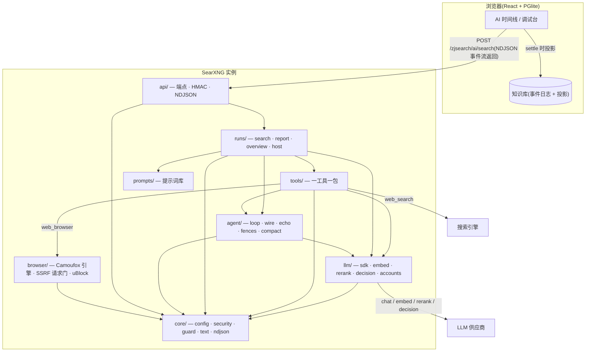
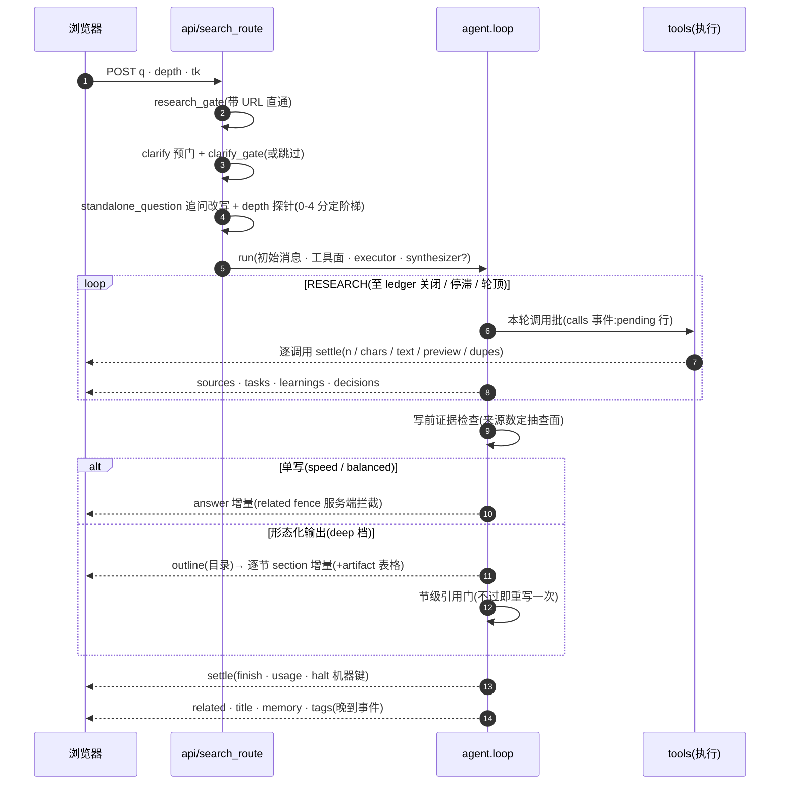
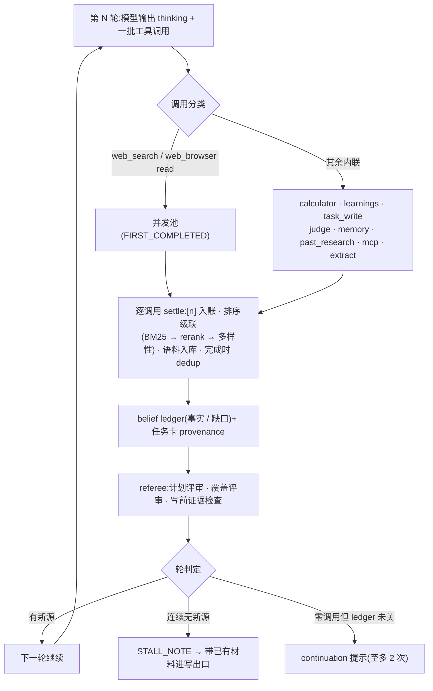
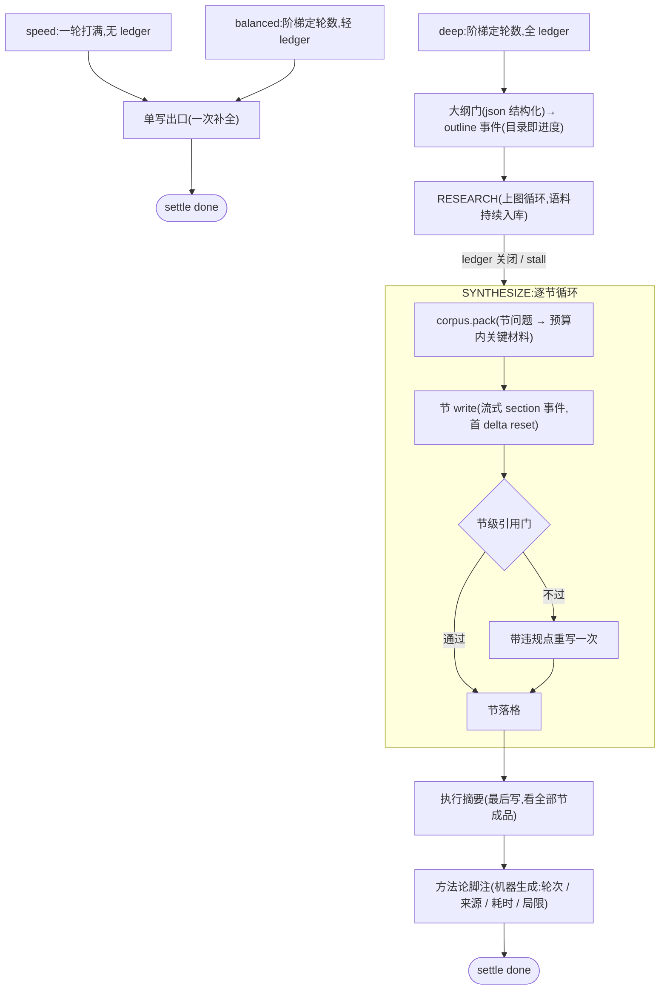
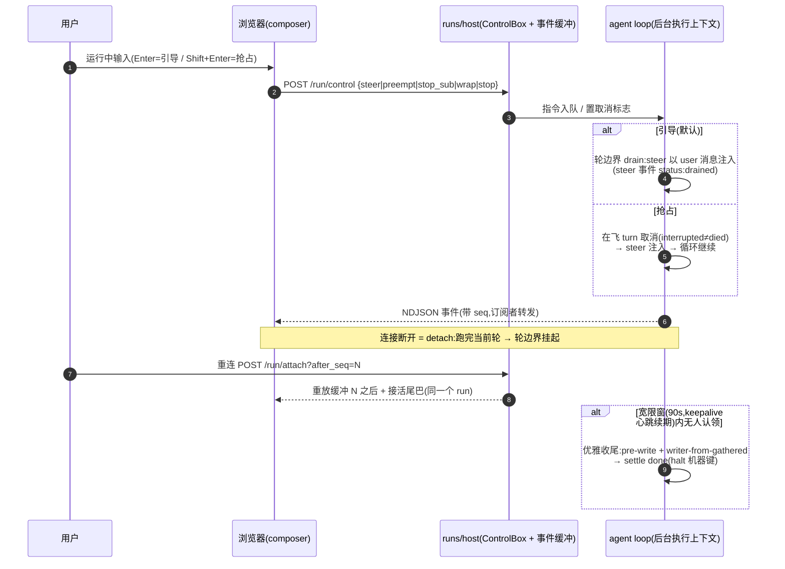

# ZJSearch AI 栈 — 架构与设计(现行)

本文档描述 `searx/zjsearch/` AI 栈的**现行设计**:包结构、契约、harness
模型与关键机制。历史上的提案论证(v2 结构重排、v2.1 多代理/干预/Run
Host)、问题清单与逐日实施日志已清理,可在 git 历史查阅本文档的旧版。

> 运作手册(全部约定、坑与调试经验)= **AGENTS.md**;本文只回答"设计是
> 什么、为什么这样划界"。文末五张图与代码同步维护:**改结构先改图**。

---

## 0. 总览

| 能力 | 设计一句话 |
|---|---|
| 四档单循环 | speed / balanced / deep 是预算与停机策略的差别;report / deck 是 deep 之上的**输出形态**(大纲门 → 逐节合成),不是第四种 agent |
| Run Host | run 的命与客户端连接解耦:断开 = detach,重连 = reattach 同一个 run;宽限超时优雅收尾,每个 run 都有真实终态 |
| 控制面 | 运行中引导(轮边界注入)/ 抢占(中断当前 turn 后注入)/ 停子代理 / 收尾 / 停止——永不静默打断在飞流 |
| 子代理 | `research_subtask` 起嵌套 loop:独立上下文 + 共享 [n] 注册表 + 摘要回传;delegation gate 按深度档 + rung 开放;子代理可追问、可后台、可独立停止 |
| 上下文工程 | 转写三级折叠(microcompact / auto-compact / reactive)+ Run Corpus(运行内语料检索)逐节装配 writer 上下文 |
| 诚实机制 | 事实台账(learnings)+ 覆盖裁判 + 写前证据检查 + 节级引用门 + 交付物实体启发式;stall 与失败全部成为 writer 的诚实上下文 |
| 人-in-the-loop | clarify 预门(歧义/高风险两 noul)+ 运行中 `ask_user`;付费引擎 !bang 的一次性确认门 |
| 知识库 | 浏览器本地 PGlite:事件日志 + 投影,混合召回(BM25×向量 RRF + 标签图 + 命中标签一跳)|
| 渲染引擎 | 内置 Camoufox 反检测 Firefox:指纹 OS 钉 windows(镜像构建随之裁掉其余 OS 专属字体组,~850M),构建期预取指纹模型/GeoIP/uBlock,首启零网络 |

---

## 1. 包结构与依赖规则

八个包,依赖**严格向下**:

```
api → runs → tools → agent → llm → core
                      tools → browser → core   (browser 在 llm 旁)
prompts 是被 runs / tools 消费的素材库(不 import 逻辑)
```

```text
searx/zjsearch/ai/
  core/        config · security(HMAC)· guard(SSRF)· convert(markitdown)
               ndjson · text(共享守卫)· wire_format(闭集字母表,core 叶子)
  browser/     config(可用性门)· engine(Camoufox 常驻上下文)· gate(请求级
               SSRF 栅栏)· session(交互页)· extract(渲染即抽取)·
               install(构建期安装 + 预取)· trim_fonts(镜像字体裁剪)
  llm/         sdk/(每 SDK 家族一工厂:openai · anthropic · gemini ·
               dashscope · ark · typesafe)· streaming · usage · caching ·
               jsongate(结构化输出咽喉)· embed · rerank · decision ·
               accounts(run 级用量账本)· retry(唯一重试边界)· config
  agent/       loop(相位机:RESEARCH → WRITE)· wire(闭集校验)·
               executor(契约)· echo / fences(跨方言思维回显 + 流分割)·
               compact(转写折叠)
  prompts/     spine(共享骨架:身份/引用/markdown/voice/答案契约)·
               researcher · report · deck · extractor
  tools/       一工具一自包含模块(spec + run + settle + 行语义):
               web_search · web_browser/(read 并行读道 + session 服务)·
               calculator · extract(表格/数据点产物)· learnings · tasks ·
               ask_user · judge · memory · past_research · view_image ·
               engine_info · research_subtask · mcp
  runs/        profile(档位/预算)· host(Run Host)· journal(run 日志)·
               overview(AI Overview)· attachments(多模态附件)
    search/    state · gather(并发执行)· registry([n] 注册表/dedup)·
               rank(排序级联:引擎序 → BM25/RRF → rerank → 多样性)·
               feed(writer 紧凑源块)· coverage · referee(计划/覆盖裁判)·
               gates(延长/停机等结构门)· corpus(Run Corpus)· context ·
               writer · handlers · recall(活召回槽)· entity_gate ·
               progress · audit
    report/    outline(大纲门)· synth(逐节合成,report/deck 共用)
  api/         search_route · run_host_route(attach/control/keepalive/
               journal)· overview_route · embed/rerank/decision/tag/recall
               (HMAC 代理)· thread_page · knowledge_page · browser_input ·
               http(共享路由前奏)
```

分层守护:静态扫描 import 边,断言无向上/跨包违例;`core.ndjson` 不得
为拿闭集校验而 import agent(字母表在 core 叶子 `wire_format`,agent.wire
只 re-export)。

---

## 2. 工具契约

每个工具自包含:**spec**(模型可见的 JSON schema + 描述)· **run**(执行)·
**settle**(wire `call` 结算载荷 + 对 writer/corpus 的 feed 贡献)· **行语义**
(前端 settlement-view 的 label/metric)。`tools/__init__.py` 是唯一装配与
派发表;并发语义在工具上声明(搜索/读页进并发池,其余内联)。新增工具 =
一个模块 + 注册一行 + 前端一个 view(未知工具兜底到通用行,不静默破相)。

与 MCP 的边界:`zjsearch.mcp` 把外部 streamable-HTTP 服务器桥接成
`mcp_<server>_<tool>` 工具;超过 8 个工具总量后走渐进披露(一个
`mcp_search_tools` 发现工具,按关键词取完整 schema)。

---

## 3. Wire 协议(NDJSON,闭集)

事件是**时间线操作**,每条 delta 带自己的 entry id 与 channel,客户端只
追加、从不重构。闭集(misspelling 即 raise,不是静默丢弃):

- 时间线:`open`(kind: research|write|sub)· `phase`(规划→检索→撰写)·
  `think` / `say`(增量)· `calls`(批次)· `call`(单调用结算:
  n/chars/text/preview/dupes/page/img/snapshot… 全工具共用一个事件形状)·
  `close`
- 快照(replace 语义):`tasks`(任务卡)· `learnings`(事实台账)·
  `sources`([n] 全局注册表)· `decisions`(命名裁决图)· `outline` /
  `artifact` / `section`(报告/演示文稿三件套)
- 门与流控:`answer`(writer 自己的缓冲)· `ask`(clarify 与运行中
  ask_user 同 schema)· `steer`(引导:guide|preempt × drained|discarded)·
  `recall`(活召回槽)· `compact`(折叠分隔)· `browser`(会话镜像帧)
- 晚到集(settle 之后仅这些可来):`related`(附 title 契约)· `title` ·
  `memory` · `tags` · `usage`;`settle` 是终态声明
  (status: done|awaiting|error + finish/usage/halt 机器键)
- storage-only:`ctx`(断点继续的对话检查点)· `attachment`(上传转换
  回执)

终止纪律:流永不无声结束——传输死亡在首个内容事件前应答 502;晚块序列
化失败发恢复 `page_error` 载荷。

---

## 4. Harness:单循环 × 四档 × 两种输出形态

**四档是预算策略,不是四种 agent**:

| 档 | 轮数阶梯 | 停滞出口 | 写出口 |
|---|---|---|---|
| speed | 1 波内(≤6) | 1 轮无新源 | 单写 |
| balanced | 4/8/16/24/32 | 3 轮(先警告) | 单写 |
| deep | 12/24/48/96/120 | 4 轮 | **形态化输出(强制)** |

deep 档的输出形态 = 报告(分节文档)或演示文稿(Marpit 幻灯片),运行
开始后可在右栏「输出结构」卡切换(两步确认;形状切换同时给 researcher
一条引导通知,剩余轮次自适应)。共同管线:

- **大纲门**(report/deck 各自措辞的 json 结构化补全):标题/章节/
  key_questions/交付物实体(附件头自提,未覆盖实体进 researcher 上下文与
  计划裁判的 noul);模板(预设 + 用户自定义,PGlite `template` 行)在
  写边界经 `build_outline_from_template` 适配,结构绑定、标题按问题实体
  重写;
- **Run Corpus**:RESEARCH 期间持续入库(搜索全量结果、读页全文、事实、
  计算结果、extract 表格行);每节写前 `corpus.pack(section, budget)` 按
  该节 key_questions 取预算内关键材料,跨节去重靠嵌入近邻(0.92 共享
  底线);
- **逐节合成**:每节一次独立流式补全(`section` 事件,首 delta 带
  `reset: true` 替换语义),**节级引用门**在交付前抽查 [n] 支撑,不过即
  带违规点重写一次;执行摘要最后写,方法论脚注机器生成;
- **上下文三级折叠**(`agent/compact.py`):microcompact(旧轮读页正文
  塌缩为引用头)→ auto-compact(阈值上一个 text-only 补全摘要 + 机械
  状态块,前缀缓存稳定)→ reactive(供应商溢出拒绝触发一次强制折叠后
  重试);`ctx` 检查点携带折叠后的完整消息列表,断点继续零特殊处理;
- **停滞策略**:无新源的轮先追加"换角度"注记,连续无新源按档停机;
  `web_search` 的 `refresh: true` 是模型主动重跑已执行查询的 judged 逃生
  门;纯记账轮既非进度也非停滞;
- **付费门**:API 计费引擎的 `!bang` 一次调用一确认(`approval` 结算 +
  ask_user 往返,`paid_ok` 粘滞整个 run);
- **人在环路**:clarify 预门两 noul(歧义/高风险),ask_user 单轮一问、
  最多三问;高风险交付物必问。

**排序级联**(`runs/search/rank.py`,刻意不是工具):引擎序 → BM25/RRF
(经典页 tokenizer 复用)→ `zjsearch.rerank` 端点头 20 重排 → 嵌入多样性
剪枝 + 跨搜索记忆(已喂过的近重复 url 不再铸 [n])。每段都有界且
fail-open,重排 token 计入 `usage.rerank` 桶。

---

## 5. Run Host 与控制面

run 跑在 driver 线程,事件发布进 per-run handle(seq 戳缓冲 + 订阅者);
HTTP 响应只是第一个订阅者。

- **detach ≠ 死亡**:断连后 run 完成本轮、停在轮边界;`POST
  /zjsearch/ai/run/attach?after_seq=N` 重放同一个 run;超宽限窗
  (`detach_grace`,默认 90s,后台页 keepalive 心跳续期)优雅收尾——
  halt 注记进 settle,每个 run 都有真实终态;
- **停止是指令**:`POST /zjsearch/ai/run/control {action}`;loop 以 1s
  切片观察标志,被中断的 turn 是 `interrupted` 结局(不是 `died`);
- **引导**:Enter 入队轮边界注入(`steer` 事件 drained,`<user_steering>`
  user 消息,优先于 continuation 注记);⚡/Shift+Enter 抢占(在飞 turn
  取消后注入继续);写相关闭引导道,未送达可见作废;
- **子代理**:delegation gate(deep 从 rung 2、balanced 从 rung 4)开
  `research_subtask`——嵌套 loop、自己的工具面(含 learnings 与 judge)、
  预算与 `ChildControl`;**共享 [n] 注册表**让重复搜索结算为 duplicate;
  回传 = 事实/缺口摘要(facts/gaps 即子代理的 digest);子代理可寻址:
  `message_subtask` 跨进程边界追问(checkpoint 持久化 + 重放再水化),
  批次超时晋升后台道,停止单子代理 ~1s 内生效、已收集来源保留;
- **journal**:每个 run 影子写入本地 SQLite(`runs/journal.py`,
  `%TEMP%`,72h TTL)——进程重启/终态 TTL 之后仍可重放;恢复阶梯:探测
  活 handle → journal → 接受中断态。

---

## 6. 客户端

- **哑渲染器**:`useAiSearch` 把时间线事件一比一折叠成步骤/缓冲/
  快照;`applyEvent` 同时服务直播与存储回放(一个 reducer,两种执行)。
- **行内核 + settlement-view**:全部工具行共享一个内核(开合状态机 +
  Collapse 编排),每工具一个声明式 view(label/metric/展开体/Debug);
  机器产物上 machine-voice 底,渲染结果与 debug 材料分行。
- **右栏一个均匀面**:浏览器实况 → 已确认方向 → 调研计划 → 研究发现 →
  来源 → 决策结果;cap-and-expand 统一 `useCapExpand` + `CapChip`,
  citation-locate 链走 `setTimeout`。
- **文档与幻灯片**:`DocumentView`(TOC + 逐节流渲染)与 `DeckView`
  (marpit 内核按节编译缓存、溢出自适应缩放)共用大纲状态;打印是
  self-contained 纸面(文档局部重编号 [1..N],浏览器打印对话框保留
  同文档锚点)。
- **知识库**:PGlite worker(WASM Postgres + IndexedDB,主线程回退有
  预算护栏);schema v5 把 wire 日志(`run_event`)与查询面(投影)分
  表;混合召回 = BM25×向量 RRF + 标签图 0.6 + 命中标签一跳 0.4,头部过
  rerank;标签三层(机械 derive → 运行后抽取器 → `/zjsearch/ai/tags`
  概念折叠)。经典搜索历史刻意不入库——知识库只记 AI 研究与 AI
  Overview 归档。

---

## 7. 架构图解

### 1. 八包分层与依赖方向



### 2. 一次请求的 wire 时序



### 3. RESEARCH 循环(各档共用引擎)



### 4. 档位与 SYNTHESIZE

| 档 | 轮数阶梯 | 停滞出口 | 写出口 | 产物 |
|---|---|---|---|---|
| speed | 1 波内(≤6 轮顶) | 1 轮无新源即停 | 单写 | 短答 |
| balanced | 4 / 8 / 16 / 24 / 32 | 3 轮 | 单写 | 适中答案 |
| deep | 12 / 24 / 48 / 96 / 120 | 4 轮 | **形态化输出(强制)** | 报告文档 / 演示文稿 |



### 5. 干预与恢复时序(steer / detach / reattach)


