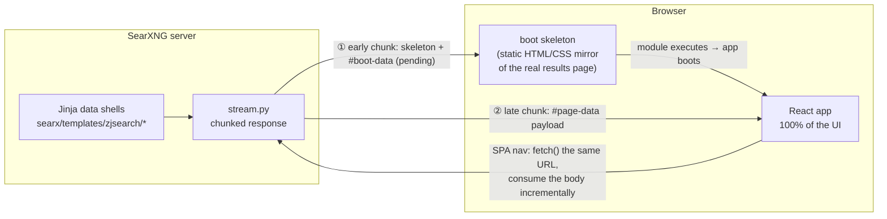
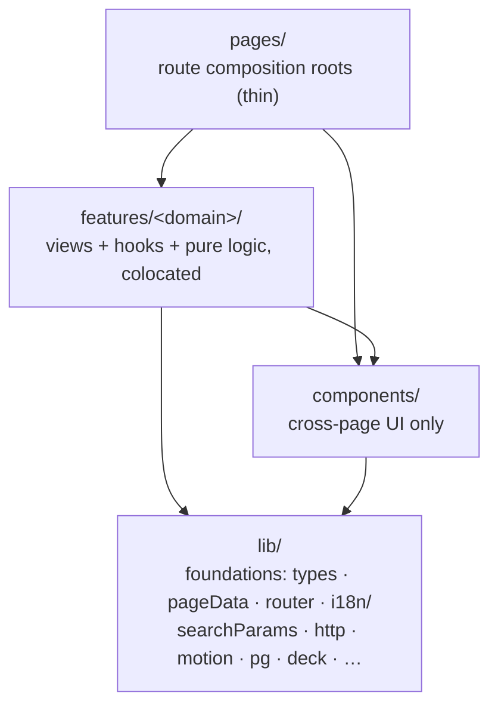
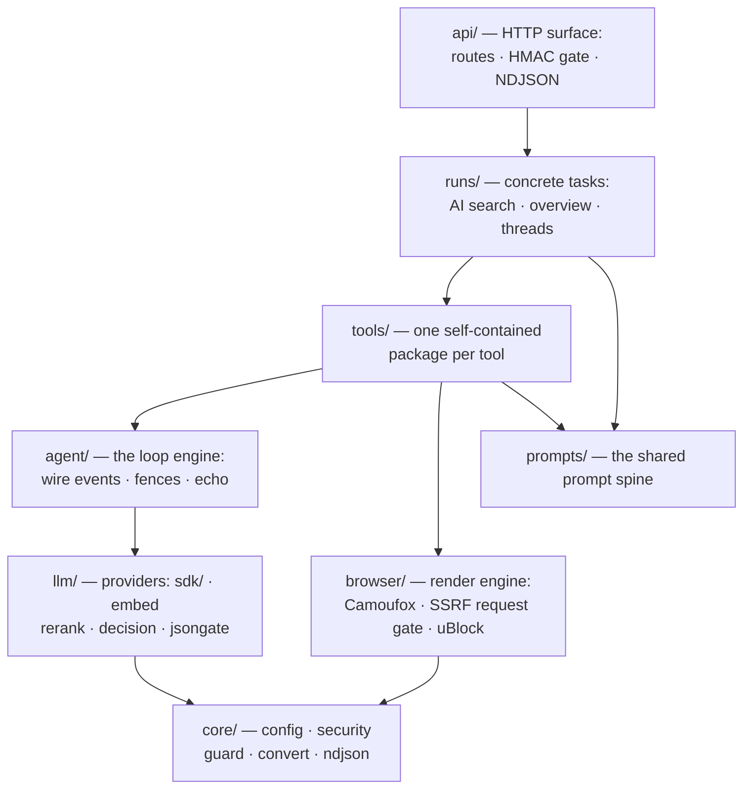

# ZJSearch


A from-scratch **React + TypeScript UI theme for SearXNG**. The SearXNG
server keeps rendering every page — but the theme's Jinja templates are
thin *data shells*: they serialize the render context into a JSON payload
(`<script id="page-data" type="application/json">`) and boot the React
bundle, which renders **100% of the interface**.

The theme conforms to the family design contract `DESIGN.md` (ZJBlog
repository) — palette tokens, component fragments, motion rules and
quality gates are family-wide.

**Additive-first upstream policy.** Upstream `searx/` files are not
edited: the theme's Python ships as new files (the streaming module, the
`searx/zjsearch/` package, plugins, templates) plus **one** appended
`install(app)` hook at the end of `webapp.py`, so rebases stay
conflict-free. `searx/settings.yml` is upstream-frozen — configuration
lives in the deployment's own settings file
(`client/zjsearch/dev-settings.yml` for development).

---

## Architecture

### The Page-Data pattern (streamed)

Search pages **stream**: the head + a static boot skeleton flush
immediately (the search box is interactive while the engines still run),
and the real payload arrives in a late chunk. SPA navigations consume the
same response incrementally — the skeleton paints the moment the early
chunk parses, the completed payload settles the view. The client never
re-fetches what the server already sent.



- **Data contract** — `searx/templates/zjsearch/data/macros.html` is the
  server → client contract, mirrored by TS types in
  `src/lib/types.ts`. **Keep both in sync.** Macros apply the server
  filters during serialization (`image_proxify`, `favicon_url`,
  `get_pretty_url`, query highlighting); `title_html` / `content_html`
  are escaped HTML and render through `dangerouslySetInnerHTML`.
- **Client-side navigation** — `src/lib/router.tsx` fetches the same
  `/search` / `/preferences` / … URLs and extracts the embedded
  page-data JSON; on network failure it falls back to a full page load.
  Parameter encode/decode + the shared page fetch live in
  `src/lib/searchParams.ts`, so the GET URL, the POST form body and the
  infinite-scroll pager derive from one entry list.
- **Payloads are single-use** — the boot consumer and the router's
  pending consumer remove every `#page-data` element they read; a stale
  element would otherwise re-apply an old page over a fresh navigation.
- **Streamed = fail-safe** — a late-chunk serialization error emits a
  recovery `page_error` payload; a streamed response never ends
  silently after the shell.
- **Skeletons are universal** — every surface renders its own real shape
  while it loads (classic results, AI takeover, lazy chunks, overlay
  panels, the knowledge graph, thread resume). A load state that renders
  an empty message while data is in flight is a bug.

### Client layers

Dependencies point strictly downwards; imports use the `@/` alias.



- `lib/` never imports from `components/` / `features/` / `pages/`.
- `features/<domain>/` owns a cohesive domain: `results/` (layout
  detection, cards/grids, answers, **aiSearch/** — the AI run surfaces,
  aiOverview), `knowledge/` (the browser-local research memory UI),
  `overlay/` (slide-in panels, injected by `app.tsx`), `hotkeys`,
  `calculate`.
- `pages/` composes: state + event handlers + layout wiring.
  Page-private pieces sit next to the page.
- **i18n is theme-owned**: `src/lib/i18n/` holds one catalog per locale;
  `en.ts` is the source and defines the `StringKey` union, so `t()`
  calls and every translation are compile-checked.

---

## The AI stack

`searx/zjsearch/ai/` is an eight-package stack behind the same
additive-first policy — AI search threads (three depth tiers — speed /
balanced / deep, the AI Overview being the fixed quick task — with
report and deck output shapes), the AI Overview card on classic results,
a run host that decouples runs from client connections (detach /
reattach / steering), subagents, a browser-local knowledge base
(PGlite — research history never leaves the browser — that doubles as
the researcher's memory: facts, procedures, lessons, open gaps, site
recipes), an MCP tool bridge and a built-in anti-detect render engine
(Camoufox):



The wire protocol is NDJSON timeline operations (open/think/say/calls/
call/close/sources/plan/findings/answer/ask/decisions/phase/browser/
settle — a late post-settle set carries related/memory/tags/usage) —
`useAiSearch` is a dumb renderer over those ops, and stored threads
replay through the exact same fold. The **AI debug stage**
(`/zjsearch/debug/thread`) replays a fixture catalog through that real
fold — every tool row kind × status, the report/deck documents, the
clarify gate, steering, browser ops and the pasted-brief long-text case
— so a new surface ships with a fixture and is QA-able without a live
run.

> **Deep documentation:** [`AGENTS.md`](../../AGENTS.md) is the
> operational manual (architecture, contracts, conventions, debugging
> lore — the single source of truth for working on this repo), and
> [`NEXTGEN-DESIGN.md`](../../NEXTGEN-DESIGN.md) is the dated design log
> behind the AI stack.

### Configuration quickstart

AI surfaces are opt-in through the instance settings' `zjsearch.*`
blocks. The LLM transport:

```yaml
zjsearch:
  llm:
    enabled: true
    sdk: openai   # openai (= Responses API) | openai.chat_completions |
                  # openai.responses | anthropic | gemini | dashscope
                  # (ark: embeddings only — its chat rides openai compat)
    base_url: "https://api.openai.com/v1"   # verbatim, per SDK convention
    api_key: ""    # or the ZJSEARCH_AI_KEY environment variable
    model: "gpt-..."
```

`params` carries the chosen SDK's `create()` kwargs verbatim under their
SDK names; `extra_body` / `extra_headers` pass through 1:1 on every
dialect. Sibling blocks configure the rest of the stack:
`zjsearch.embedding`, `zjsearch.rerank`, `zjsearch.decision`,
`zjsearch.browser` (the render engine), `zjsearch.reader`,
`zjsearch.mcp` (external tool servers) — see `AGENTS.md` for each
block's keys.

---

## Repository layout

```text
client/zjsearch/
├── dev-settings.yml       # local instance settings (default_theme: zjsearch)
├── audit-settings.yml     # instance settings for the Lighthouse gate
├── scripts/audit.mjs      # pnpm run audit: instance on :8907 + thresholds
├── Dockerfile             # self-contained image: clones upstream + this
│                          # branch, applies the patch, builds the frontend,
│                          # bakes the browser bundle (installer + font trim)
├── make-patch.sh / .ps1   # exports the whole theme delta as zjsearch-theme.patch
├── vite.config.ts         # build → searx/static/themes/zjsearch, dev proxy, @ alias
├── tools/assets.ts        # favicon/PWA rasterization, static-root publishing,
│                          # gzip/brotli siblings, PGlite worker artifacts
└── src/
    ├── main.tsx           # boot: parse page-data + client_settings, mount
    ├── app.tsx            # providers + page switch + overlay panel registry
    ├── styles/            # tokens · base · noscript · boot · prose · behaviors
    ├── lib/               # foundations (no UI): types (server contract),
    │                      # pageData, searchParams, router, i18n/, categories,
    │                      # cookies, settings, theme, format, link, motion,
    │                      # http, dialogFocus, clipboard, styles (shared class
    │                      # fragments), pg (browser-local PGlite store),
    │                      # deck (Marpit pipeline), kb/, exporters, print
    ├── components/        # shared UI: Shell, SearchBox (+ the AutoGrowTextarea
    │                      # ask panes), SearchControls, Dropdown, Collapse,
    │                      # ClampReveal, CapChip, BootGhosts, Meter, Tape,
    │                      # PaperEmpty, SettingParts, …
    ├── features/          # one dir per cohesive domain:
    │   ├── results/       #   layout detection, cards/grids, answers,
    │   │                  #   aiSearch/ (the AI run surfaces), aiOverview
    │   ├── knowledge/     #   the research memory (directory, inspector,
    │   │                  #   tag graph, admin, templates)
    │   ├── overlay/       #   slide-in panels (injected by app.tsx)
    │   ├── hotkeys.ts
    │   └── calculate.ts
    └── pages/             # route composition roots (thin); page-private
                           # pieces sit next to the page (preferences/tabs/)
```

---

## Design system

The visual language is tokenized and audited; keep new UI on these rails
instead of inventing sizes/colours.

### Type scale — one size per role

| Tier | Used for |
|---|---|
| 12px `text-xs` | meta/captions — engine chips, pretty URLs, mono chrome, footer (the information floor) |
| 13px `text-[13px]` | interactive controls & compact descriptions — tabs, dropdowns, pills, suggestions. *"If it clicks, it is 13px"* |
| 14px `text-sm` | body text (card snippets), infobox abstract, settings rows |
| 16px `text-base` | result titles and ALL search inputs |
| 17px/1.8 serif | the long-form reading scale — AI answers, reports, documents |
| 20px / 24px | infobox title (serif) / page headings |

Weights: `font-extrabold` brand only, `font-semibold` headings,
`font-medium` emphasis/selected, body regular.

### Colour & surface rules

- Only the `--*` custom properties from `styles/tokens.css`. Every ink
  token keeps ≥4.5:1 contrast against every surface in all three
  palettes (light / `.dark` / `.black` OLED).
- `accent` is the light-mode *text* accent; `accent-strong` is a
  fill/border accent only — text on an `accent-strong` fill is always
  `accent-contrast`.
- Fixed-dark media chrome (lightbox, tile badges, scrubs) is
  intentionally theme-independent and says so at its definition site.
- Grid density is **container-query driven**: the results column is an
  `@container` and every grid keys its columns off the column width —
  never `sm:`/`xl:` viewport breakpoints.

### Motion, disclosure, feedback

- Every JS-initiated scroll goes through `animateScroll()` /
  `scrollIntoViewAnimated()` (`lib/motion.ts`) — native
  `behavior: "smooth"` is silently dropped by some webviews.
- JS-toggled collapse goes through `components/Collapse.tsx`; modal
  dialogs mount through `useDialogFocus`; one-shot confirmations go
  through `flashToast()` — never render feedback in flow.
- Long content clamps through `components/ClampReveal.tsx` (measured
  preview + gradient scrim + expand pill); the AI run title uses it to
  hold pasted research briefs at three lines — the boot ghost's
  `line-clamp-3` and the static skeleton's `-webkit-line-clamp` mirror
  the same height, so the three-way handover never shifts.
- The ask panes (hero card + both follow-up composers) are
  `components/AutoGrowTextarea.tsx`: one line tall at rest, grows with
  a pasted brief to ~8 lines then scrolls internally; Enter submits,
  Shift+Enter is a newline (the preempt-steer lane while a run
  streams), and IME composition always owns Enter.
- Shared Tailwind fragments live in `lib/styles.ts` (`CHIP`, `ICON_BTN`,
  `META_ROW`, …) and panel furniture in
  `components/SettingParts.tsx` — import, don't re-type.
- All HTTP calls go through `lib/http.ts` (`fetchText`/`fetchJson` with
  a uniform `HTTP <status>` error).

---

## Development

The client is a **pnpm** workspace (`pnpm-lock.yaml`, `packageManager`
pinned) — use pnpm for everything here; the upstream `simple` theme
keeps its own npm lockfile.

```sh
make themes.zjsearch          # pnpm install + vite build → searx/static/themes/zjsearch
make themes.zjsearch.lint     # biome check + tsc --noEmit
make themes.zjsearch.dev      # vite dev server (HMR), proxies API calls to :8888

# the local instance (first: ./manage pyenv.install)
SEARXNG_SETTINGS_PATH=$PWD/client/zjsearch/dev-settings.yml ./manage webapp.run
```

| Command | What it does |
|---|---|
| `make themes.zjsearch` | production build into `searx/static/themes/zjsearch` (git-ignored) |
| `make themes.zjsearch.lint` | the quality gate: Biome + `tsc --noEmit` |
| `make themes.zjsearch.dev` | HMR dev server; proxies `/search`, `/autocompleter`, … to `127.0.0.1:8888` (override with `ZJSEARCH_BACKEND`) |
| `pnpm run audit` | the **fully offline** Lighthouse gate (see below) |

Gotchas worth knowing before your first rebuild:

- After `make themes.zjsearch`, **restart the dev instance** — WhiteNoise
  snapshots the static dir at boot, and on Windows a running instance
  keeps serving pre-rebuild bytes (the browser caches assets for 30 s;
  reload twice before concluding a change "didn't work").
- Template edits need a restart too: Jinja caches compiled templates.
- The build publishes bundle URLs at the static root
  (`/static/zjsearch.min.js`) plus the gzip/brotli siblings WhiteNoise
  serves; the PGLite worker's hashed artifacts are content-addressed and
  immutable.

### Lighthouse audit (offline quality gate)

`pnpm run audit` boots a throwaway instance on `127.0.0.1:8907` whose
engine list is reduced to `zjaudit` (`searx/engines/zjsearch_fixtures.py`,
a deterministic offline engine keyed by query token) and points the AI
transport at a mock (`scripts/ai-mock.mjs`) — remote engines would make
the audited pages variance-sensitive. It gates the home page plus one
page per result presentation and the AI surfaces, failing below the
thresholds in `scripts/audit.mjs`. Reports archive under
`client/zjsearch/.lighthouse-archive/<run>/`; compare two runs with
`pnpm run audit:diff -- <runA> <runB>`. Desktop is the default profile
(`LH_FORM_FACTOR=mobile` opts into the harsher mobile floors); search
pages' SEO category is exempt on purpose (upstream `robots.txt`
disallows `?q=`). Needs the venv and a Chromium (`CHROME_PATH` when
chrome-launcher does not autodetect).

### Docker

`client/zjsearch/Dockerfile` builds a fully self-contained image — the
build clones upstream SearXNG master + this branch, applies
`zjsearch-theme.patch` (plus the engine backports under
`client/zjsearch/patch/`), builds the frontend inside the patched tree,
and bakes the AI render engine's browser bundle at build time: the
installer prefetches every launch-time payload (fingerprint model,
GeoIP databases, uBlock Origin) and a trimmer drops the font groups the
pinned identity OS does not read (~850 MB off the bundle).

### Selecting the theme

The theme becomes selectable by merely existing (a template directory is
a theme). Set it as default in your `settings.yml`:

```yaml
ui:
  default_theme: zjsearch
```

or pick *ZJSearch → Theme* in the preferences UI.

---

## Adding a UI language

Two edits: create `src/lib/i18n/<tag>.ts` exporting a
`Record<StringKey, string>` (a `Partial` is fine — missing keys fall
back to English), then register it in `CATALOGS` inside
`src/lib/i18n.ts` plus a mapping in `themeLocaleTag()`.

## License

The zjsearch theme is released under the Apache License 2.0 with
Commons Clause v1.0 — see [`LICENSE.txt`](LICENSE.txt) for the full
text. The license is also linked from the site footer.
